# uni-switch 0.5.29 蝶祈云新手配置教程

GPT 生图与 Claude 分组修订版。本页由最新版 36 页 PDF 转为 GitHub Markdown，包含 35 张完整界面截图，保留原图中的编号、红框和箭头。

**适用版本：uni-switch 0.5.29。** 截图采集于 2026 年 11 月 16 日；其他版本的布局可能有所变化。模型列表为本次真实 Key 下的操作示例，实际以自己的 Key 权限和当前网站说明为准。

[下载原版 PDF](uni-switch-0.5.29-dieqiyun-tutorial.pdf) · [下载 uni-switch](https://github.com/dieqiyun/uni-switch/releases) · [蝶祈云官网](https://www.dieqiyun.top/)

先完成公共准备，然后跳到自己的客户端。需要图片生成时阅读 GPT 生图配置；需要 Claude 时先添加 Claude Key 分组。GPT 和 Claude 使用同一个「蝶祈云API」供应商，通过不同 Key 分组区分。

## 阅读导航

- [开始前](#start)
- [公共准备：登录 → 创建 GPT Key → 添加供应商](#public-preparation)
- [GPT 生图配置](#gpt-image)
- [添加 Claude Key 分组](#claude-keys)
- [Codex 接入](#codex)
- [DSH 接入](#dsh)
- [Claude Code 接入](#claude-code)
- [OpenCode 接入](#opencode)
- [遇到问题](#troubleshooting)

## 开始前：打开官网

### 打开官网与选择阅读路线

1. **打开官网**

   [蝶祈云官网](https://www.dieqiyun.top/) 
   点右上角「进入控制台」。

2. **先做公共准备**

   [公共准备](#public-preparation)：登录、创建 Key、保存到 uni-switch。

3. **跳到自己的客户端**

   Codex：[Codex 接入](#codex) 
   DSH：[DSH 接入](#dsh) 
   Claude Code：[Claude Code 接入](#claude-code) 
   OpenCode：[OpenCode 接入](#opencode)

> GPT 生图：[GPT 生图配置](#gpt-image)。需要 Claude：先看[Claude Key 分组](#claude-keys)。按需阅读即可。

开始前：安装 uni-switch 0.5.29 和目标客户端，客户端先启动一次；蝶祈云账号需有可用额度。

[下载 uni-switch](https://github.com/dieqiyun/uni-switch/releases)

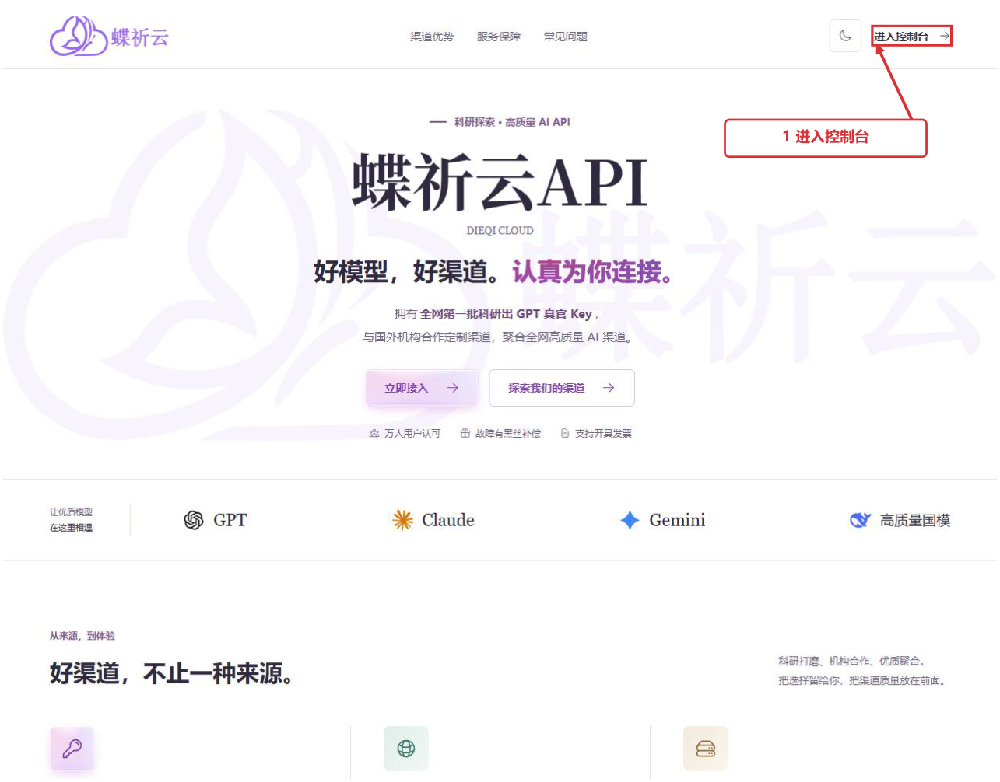

*图 1：真实官网首页，保留页面顶部导航和完整可见区域。*

## 一、公共准备：登录、创建 GPT Key、添加供应商

### 首次进入登录页：阅读条款

1. **先阅读提示**

   首次进入可能出现服务条款与隐私政策提示。

2. **同意后继续**

   阅读并同意后，点右侧「同意并继续」。

3. **进入登录表单**

   没有出现此提示的读者，直接看下一步。

> 没有账号先注册。本教程从已有账号开始。

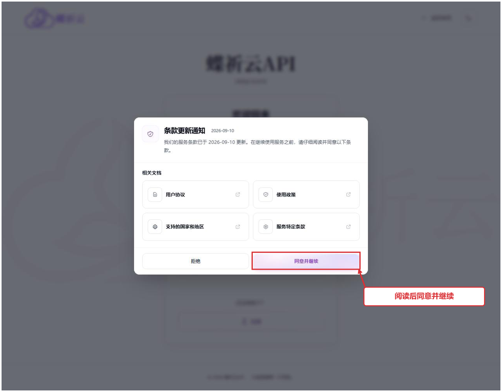

*图 2：完整登录页面与条款弹窗一起展示，保留弹窗所在的位置。*

### 填写自己的账号并登录

1. **输入邮箱**

   在「邮箱」输入框填写自己的注册邮箱。

2. **输入密码**

   在下方「密码」输入框填写自己的密码。

3. **点登录**

   登录后会进入控制台，再按下一步打开密钥管理。

> 教程使用空白登录表单演示位置。不要把账号密码填进 API 密钥输入框。

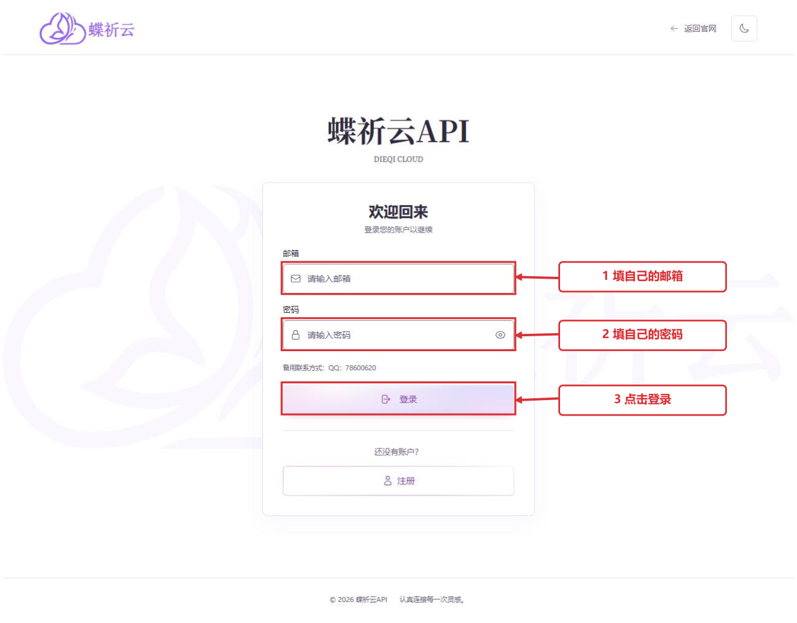

*图 3：完整登录页；邮箱和密码未填写，避免在教程中展示私人登录信息。*

### 左侧点 API 密钥，再点创建密钥

1. **点左侧「API 密钥」**

   在左侧菜单找到钥匙图标及「API 密钥」。

2. **点右上角「创建密钥」**

   打开创建窗口，下一步以 GPT 为例。

> 整张网页保留顶部导航、左侧菜单、分组监控与密钥列表。灰块是隐私遮挡。

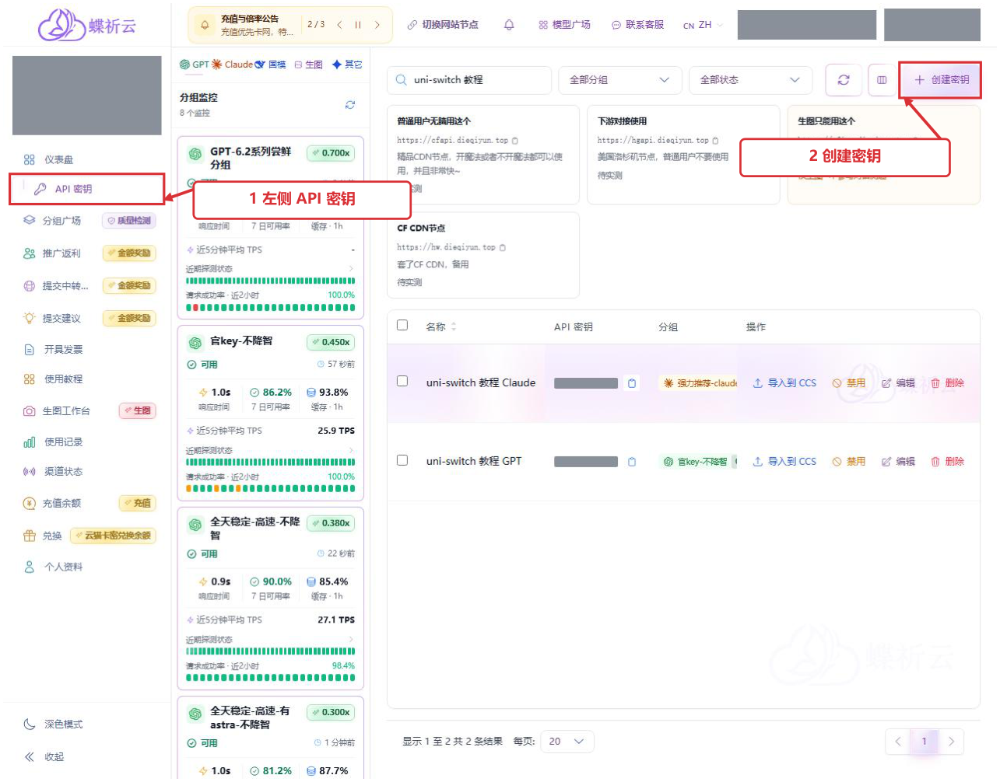

*图 4：完整密钥管理页。列表只筛选教程密钥，个人账号摘要与完整 Key 已遮挡。*

### 以 GPT 为例：填名称，选 OpenAI

1. **填一个容易认的名称**

   例如「日常 GPT」。名称只是方便自己辨认。

2. **厂商选「OpenAI」**

   要使用 GPT，就选绿色图标的 OpenAI。

3. **点「分组」**

   展开下拉菜单，继续看下一步。

> 想使用 Claude 时选 Anthropic，具体截图见[重新创建密钥，厂商选 Anthropic](#step-19)至[找到 Claude Key 并复制](#step-22)。DSH 也可以使用 GPT。

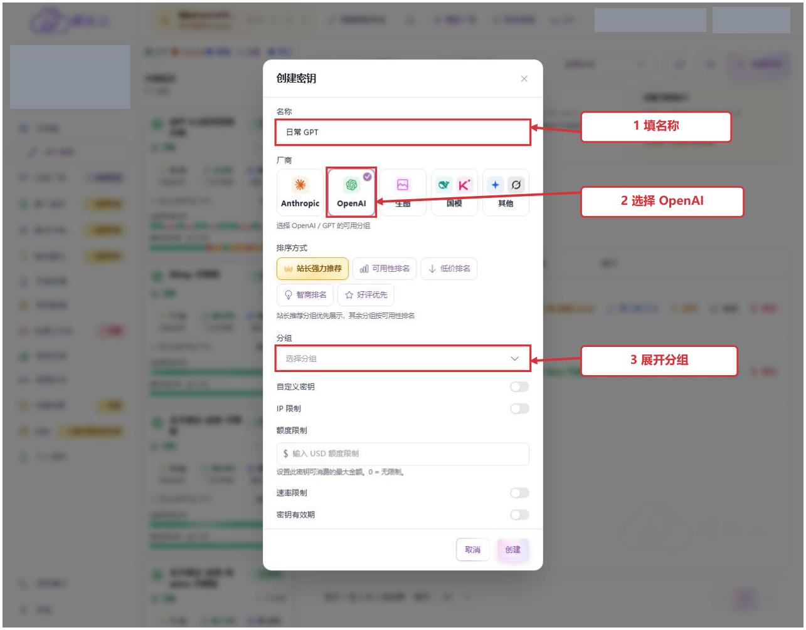

*图 5：完整网页与创建弹窗；OpenAI 出现勾选，表示厂商已选中。*

### 在下拉菜单中选择 GPT 分组

1. **展开「分组」**

   点上一步红框中的分组输入框。

2. **点击对应渠道整行**

   教程以「官key-不降智」为例。点击这一整行完成选择。

3. **按自己需求选择**

   结合页面中的价格、模型权限和渠道说明决定。

> 分组排名会变化，按名称找到目标分组即可。列表可滚动，不必与截图顺序完全一致。

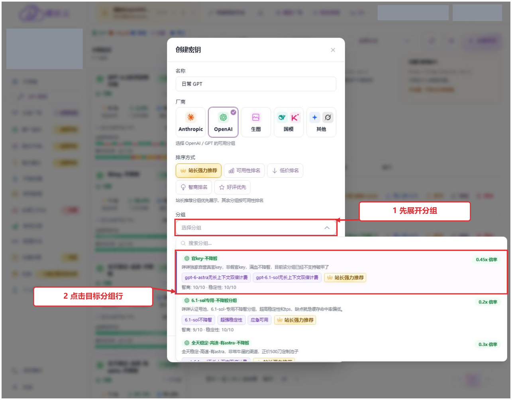

*图 6：完整网页与展开的分组菜单；箭头指向本次使用的分组行。*

### 检查分组，直接创建密钥

1. **确认厂商与分组**

   检查 OpenAI 和目标 GPT 分组是否已选中。

2. **其他项目保持默认**

   初次使用无需逐项设置。

3. **点右下角「创建」**

   回到密钥列表后，按下一步复制 Key。

> 创建后请按名称找到自己的 Key。教程不需要填写其他高级选项。

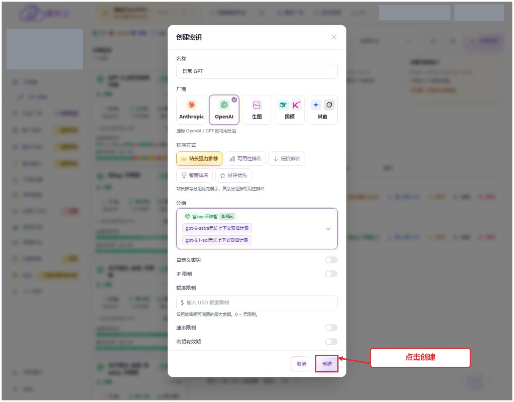

*图 7：完整创建窗口，保留默认字段，只标注需要点击的「创建」按钮。*

### 回到列表，复制完整 API Key

1. **找到刚创建的名称**

   教程列表使用「uni-switch 教程 GPT」；读者找自己填写的名称。

2. **点 Key 旁的复制图标**

   点红框里的蓝色小图标，复制完整 API Key。

3. **下一步粘贴到软件**

   不要手工照抄截图中的内容。

> API Key 用于客户端调用。保存好自己的 Key，不要公开到聊天、截图或代码仓库。

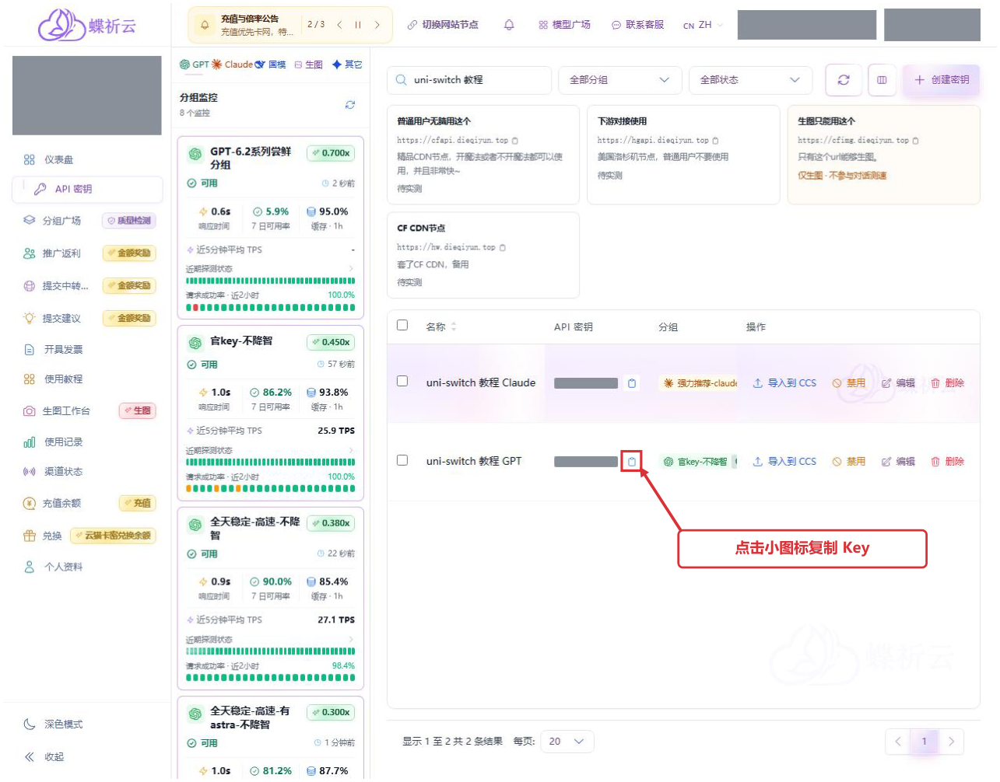

*图 8：完整密钥列表。灰块遮挡 Key，复制按钮保留在 Key 右侧。*

### 在 uni-switch 添加蝶祈云供应商

1. **打开 uni-switch 0.5.29**

   左下角可以查看版本号。

2. **点「添加蝶祈云供应商」**

   首次使用时可在页面中间看到这个按钮；已有供应商时位于右上角。

3. **准备粘贴 Key**

   下一步填写刚复制的 API Key。

> 只需添加一次蝶祈云供应商。之后在不同客户端页面复用即可。

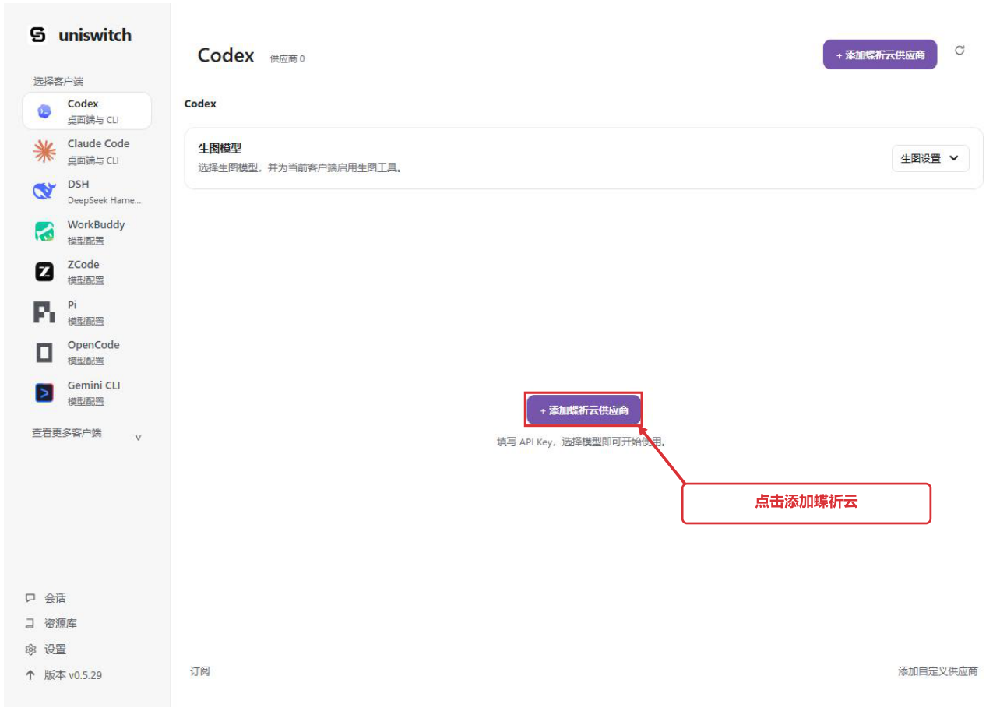

*图 9：uni-switch 0.5.29 完整主界面，保留左侧客户端列表和版本号。*

### 粘贴 Key，保留推荐项并添加

1. **粘贴完整 Key**

   填进「API 密钥」，本地分组名可填「GPT 官 Key」。

2. **保留推荐项**

   请求 URL 选「普通用户（推荐）」，请求端点选「自动（推荐）」。

3. **等模型出现，点添加**

   通常自动获取；没有出现时点「获取模型」，再点右下角「添加」。

> 本地分组名是给 Key 起的别名；网站分组决定渠道与权限。
> 完成后：需要生图：继续[在网站创建生图专用 Key](#step-11)。只用文字模型：跳[选客户端、打开开关、点使用](#step-27)、[选客户端、打开开关、点使用](#step-29)、[复用供应商并开启接入](#step-34)。

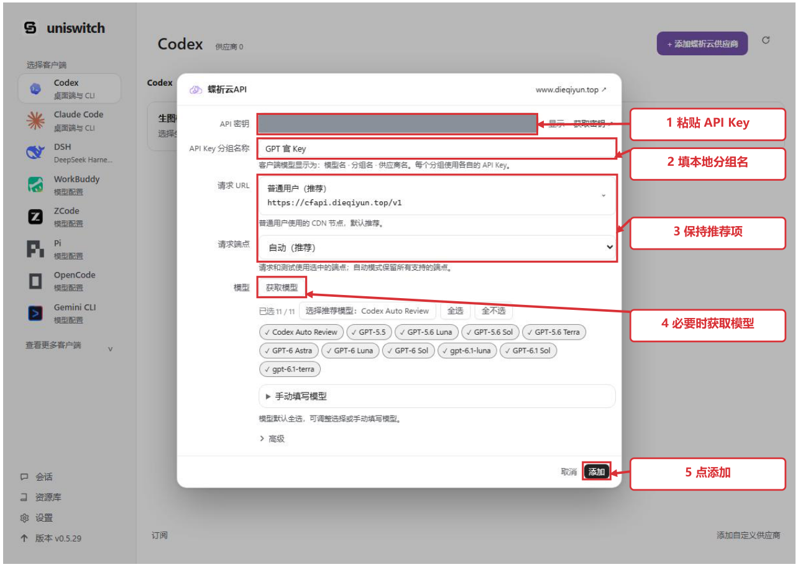

*图 10：完整添加窗口和背景界面；模型目录来自真实 Key，完整 API Key 已遮挡。*

## 二、GPT 生图配置

### 在网站创建生图专用 Key

1. **重新打开创建密钥**

   入口与[左侧点 API 密钥，再点创建密钥](#step-04)相同，名称可填「日常生图」。截图使用教程专用名称。

2. **厂商点「生图」**

   选择紫色图片图标的「生图」。

3. **展开分组**

   下一步选择支持生图的渠道。

> 本节放在 GPT 配置后。生图需要有图片生成权限的 Key，GPT 文字 Key 可能没有此权限。

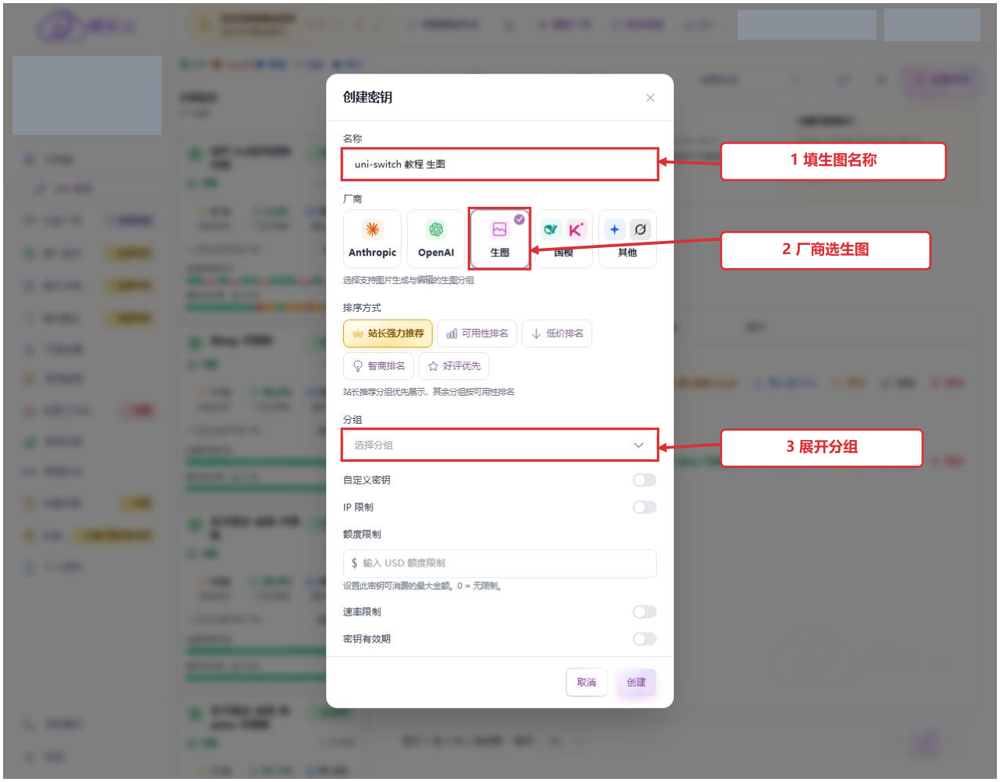

*图 11：真实网站完整界面：厂商「生图」已选中，其他项目保持默认。*

### 选择生图分组

1. **展开「分组」**

   点击分组输入框，查看可用生图渠道。

2. **选生图渠道整行**

   教程使用「N001-稳定生图分组(img2.5)」，以网站当前名称和权限为准。

3. **核对支持的模型**

   按分组说明确认模型、图片规格和价格。

> 生图渠道与文字渠道不同。分组列表、模型与价格会变化，按自己的权限选择。

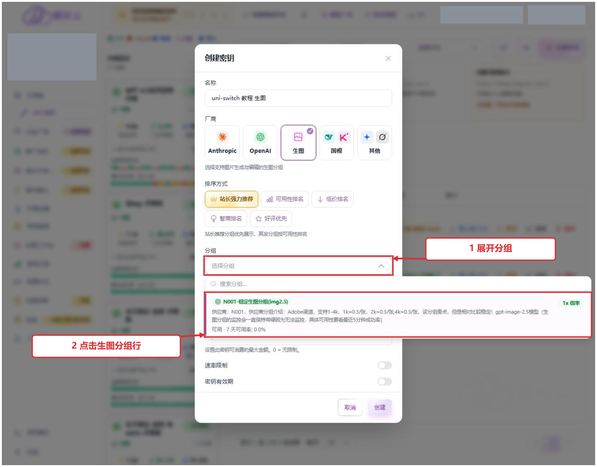

*图 12：完整网页与真实生图分组菜单；箭头指向本次示例分组。*

### 保持默认，点创建

1. **确认生图厂商与分组**

   名称、厂商和分组选好即可。

2. **直接点「创建」**

   其他项目保持默认，回到密钥列表。

> 这把 Key 用于生图设置中的 API Key 输入框。下一步复制它。

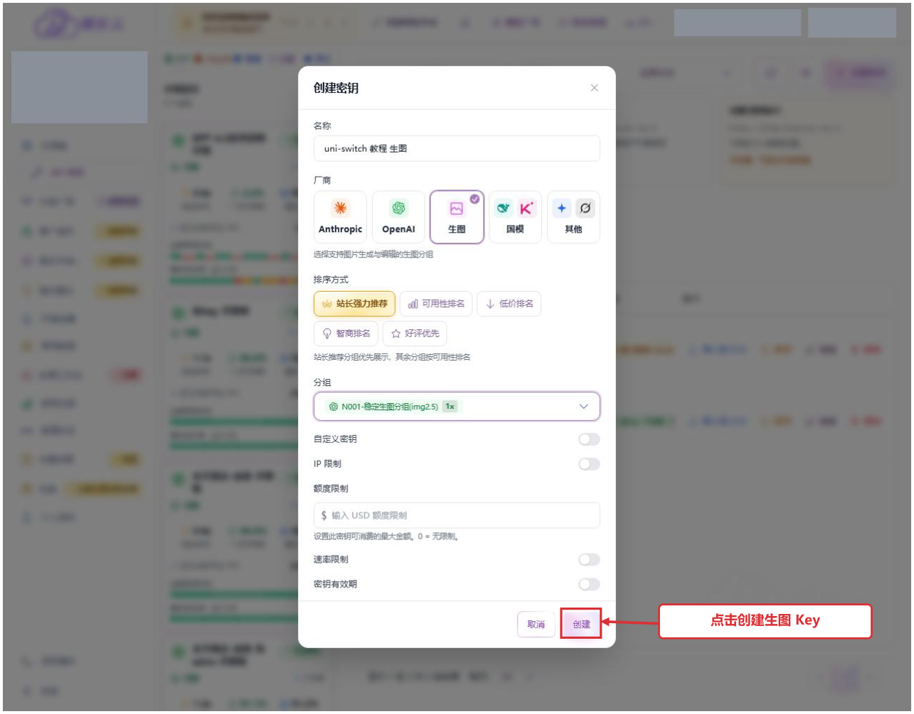

*图 13：完整生图 Key 创建窗口，使用默认字段，红框指向「创建」。*

### 复制刚创建的生图 Key

1. **按名称找到生图 Key**

   示例名称为「uni-switch 教程 生图」。读者找自己的生图名称。

2. **点 Key 旁的复制图标**

   点击红框中的蓝色小图标，复制完整 Key。

3. **回到 uni-switch**

   接下来将它粘贴到「生图设置」。

> 生图 Key 在专门的生图设置中填写。文字模型仍使用前面保存的 GPT Key。

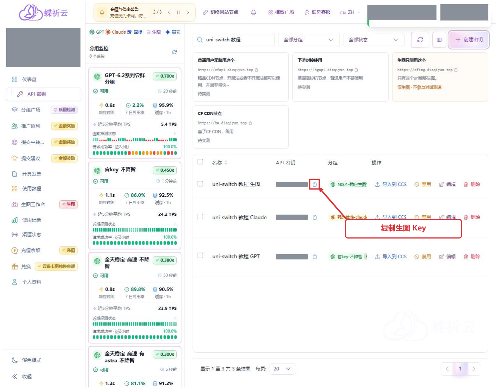

*图 14：完整密钥管理页，完整 Key 和账号摘要已遮挡，复制按钮保持可见。*

### 在 uni-switch 展开生图设置

1. **左侧选择要用的客户端**

   本节以 Codex 为例；文字模型的接入步骤见[Codex 接入](#codex)。

2. **找到上方「生图模型」区域**

   点右侧「生图设置」展开。

3. **下一步填生图 Key**

   此入口会自动使用蝶祈云生图服务。

> 生图配置放在 GPT 部分统一说明。使用 DSH 或其他支持的客户端时，也在各自页面打开这个入口。

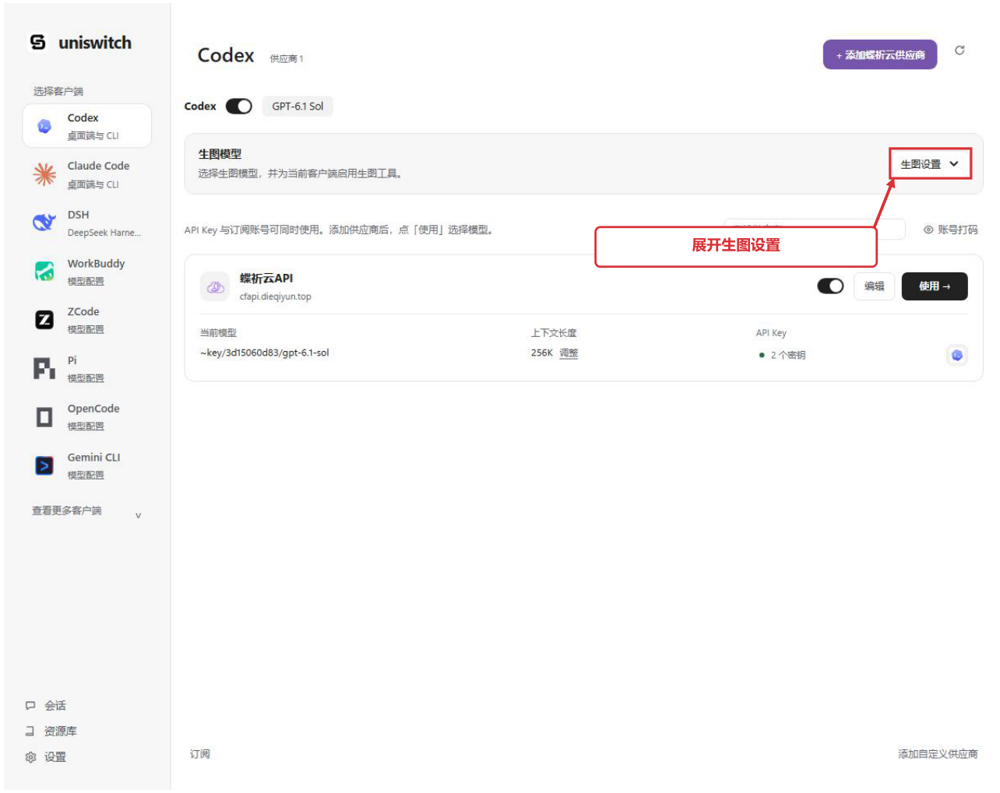

*图 15：uni-switch 0.5.29 完整界面，保留客户端侧栏、上方生图入口和供应商卡片。*

### 填写生图 Key，获取模型

1. **粘贴生图专用 Key**

   使用[复制刚创建的生图 Key](#step-14)复制的生图 Key，填到上方 API Key 输入框。

2. **等待自动获取模型**

   填写完成后会自动获取；也可点右侧「获取生图模型」或「重新获取模型」。

3. **保留默认服务地址**

   默认是 https://cfimg.dieqiyun.top/v1，无需手动填写地址。

> 本图展示已配置后的编辑状态。首次配置直接显示输入框；已配置时点「编辑」即可重新填写。

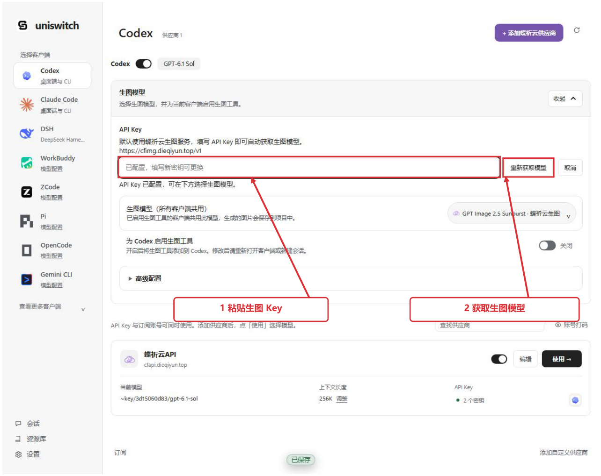

*图 16：完整生图设置界面；截图输入框为空，未显示任何完整 Key。*

### 在下拉菜单里选择生图模型

1. **点生图模型下拉框**

   找到「生图模型（所有客户端共用）」右侧的模型名称。

2. **点具体模型这一行**

   教程选择 GPT Image 2.5 Sunburst，读者选择自己的 Key 有权限的模型。

3. **确认模型名称显示**

   点选后，下拉框应显示刚选择的生图模型。

> 这里选择的是图片生成模型。上方文字对话所用的 GPT 模型仍按客户端章节选择。

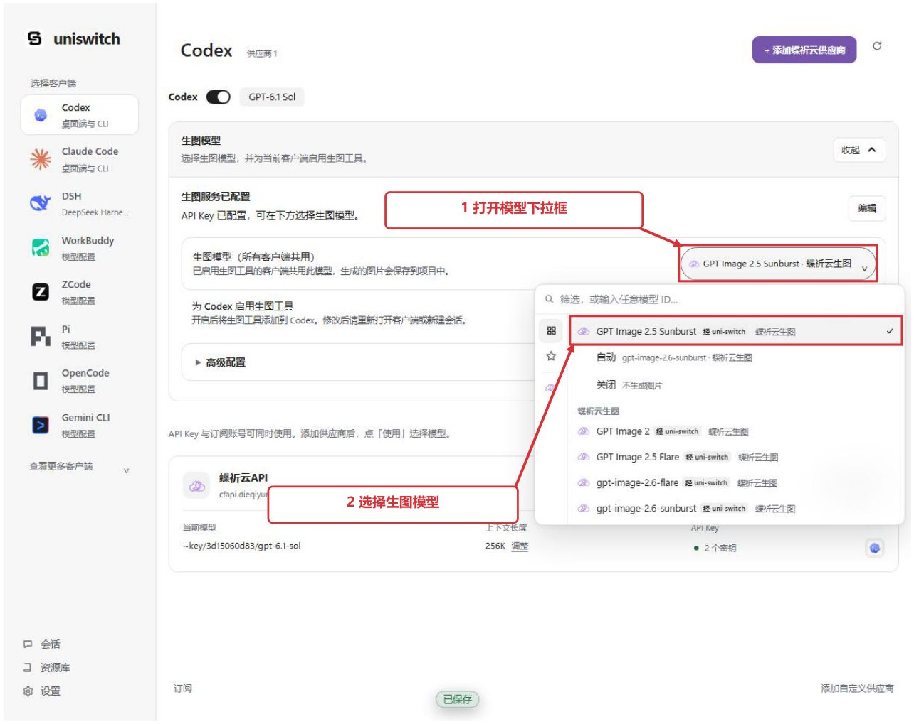

*图 17：完整界面与真实生图模型列表；目录来自已验证的生图 Key。*

### 打开工具开关，重开客户端测试

1. **打开当前客户端的生图工具**

   本图为「为 Codex 启用生图工具」，绿色并显示「开启」即已打开。

2. **重开客户端或新建会话**

   让客户端加载新添加的生图工具。

3. **发一条生图请求测试**

   例如：请调用生图工具，生成一张蓝色小猫插画，保存到当前项目。

> 生图模型由已启用的客户端共用，工具开关需要按客户端分别开启。生成图片通常会消耗生图额度。

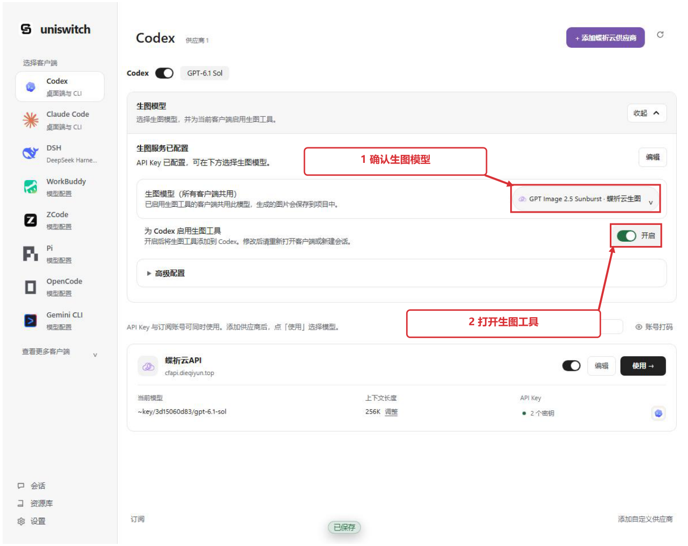

*图 18：真实生图配置完成状态。已核实模型获取、选择和工具配置；本教程未展示实际生成的图片结果。*

## 三、添加 Claude Key 分组

### 重新创建密钥，厂商选 Anthropic

1. **重新点创建密钥**

   入口与[左侧点 API 密钥，再点创建密钥](#step-04)相同。名称可填「Claude 编程」。

2. **厂商点「Anthropic」**

   选择最左侧橙色图标的 Anthropic。

3. **展开分组**

   下一步选择 Claude 对应渠道。

> 本步起为 Claude 的可选准备。只用 GPT 的读者可跳过[Claude Key 分组](#claude-keys)。

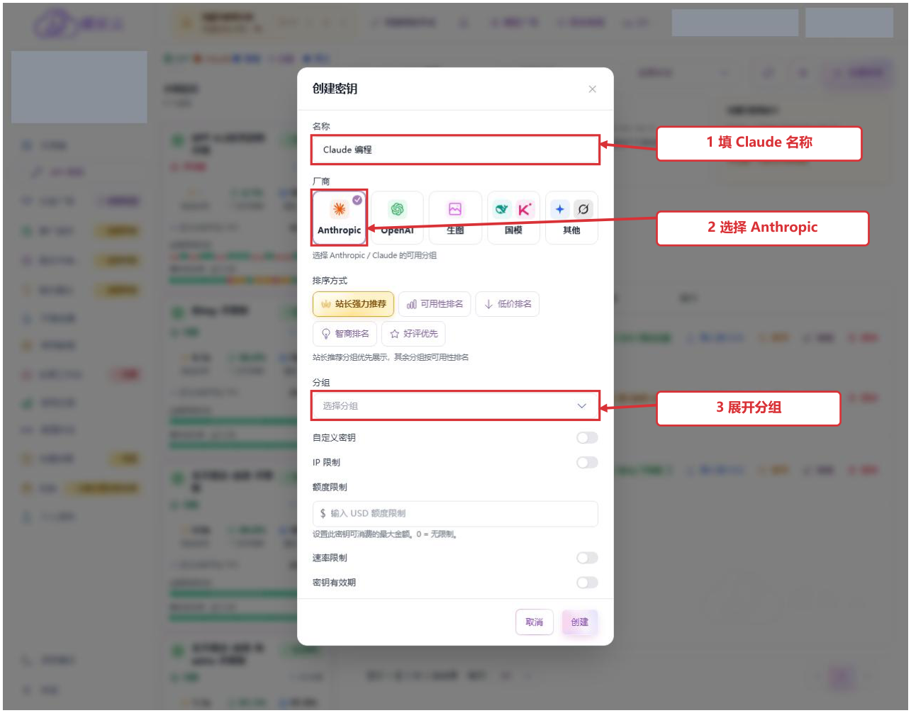

*图 19：完整网页与创建窗口；Anthropic 出现勾选，表示厂商已选中。*

### 选 Claude 分组，创建并复制

1. **选择对应渠道**

   教程使用「强力推荐-claude-高智商」，点击该分组整行。

2. **创建并复制 Key**

   收起菜单后，按[保持默认，创建 Claude Key](#step-21)至[找到 Claude Key 并复制](#step-22)直接创建并复制 Claude Key。

3. **按已有配置继续**

   只用 Claude：按[在 uni-switch 添加蝶祈云供应商](#step-09)至[粘贴 Key，保留推荐项并添加](#step-10)添加，再跳[选客户端并开启接入](#step-32)。已有 GPT 供应商：继续下一步。

> GPT 与 Claude 的 Key 权限可能不同。选择模型时，要选对应 Key 有权限的模型。

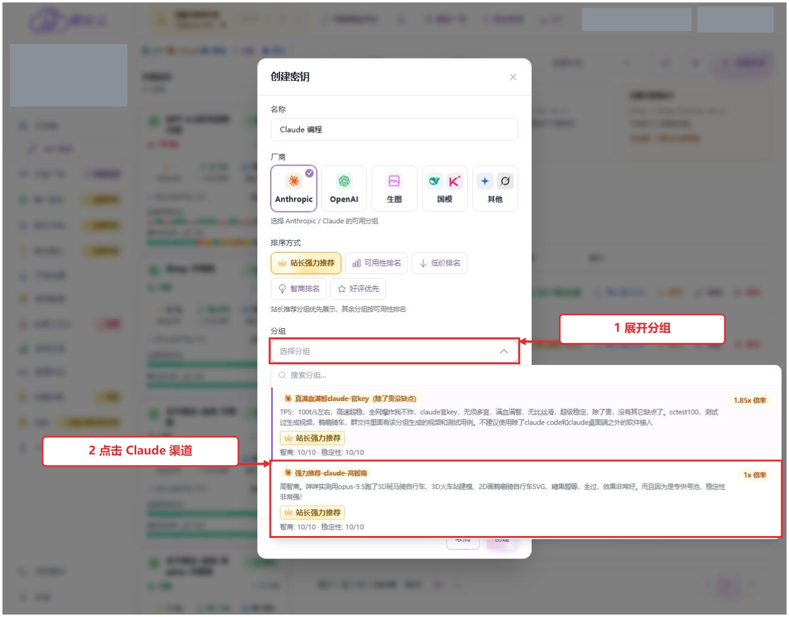

*图 20：完整网页与 Claude 分组列表；分组顺序以实际页面为准。*

### 保持默认，创建 Claude Key

1. **确认厂商与分组**

   厂商为 Anthropic，分组为自己选择的 Claude 渠道。

2. **其他项目保持默认**

   点右下角「创建」，回到密钥列表。

> 创建后先复制 Key，再回到 uni-switch 添加 Claude Key 分组。

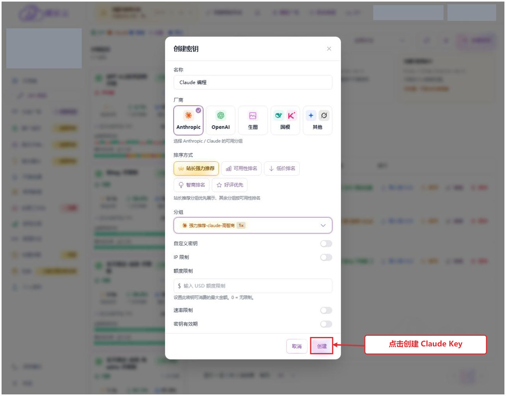

*图 21：完整 Claude Key 创建窗口，只标注右下角「创建」。*

### 找到 Claude Key 并复制

1. **找到刚才的 Claude 名称**

   本图示例为「uni-switch 教程 Claude」。

2. **点 Key 旁的小复制图标**

   复制完整 Claude Key，后面粘贴到同一供应商的 Claude Key 分组。

> 同一「蝶祈云API」供应商保存 GPT 和 Claude 两组 Key。两把 Key 按各自权限获取模型。

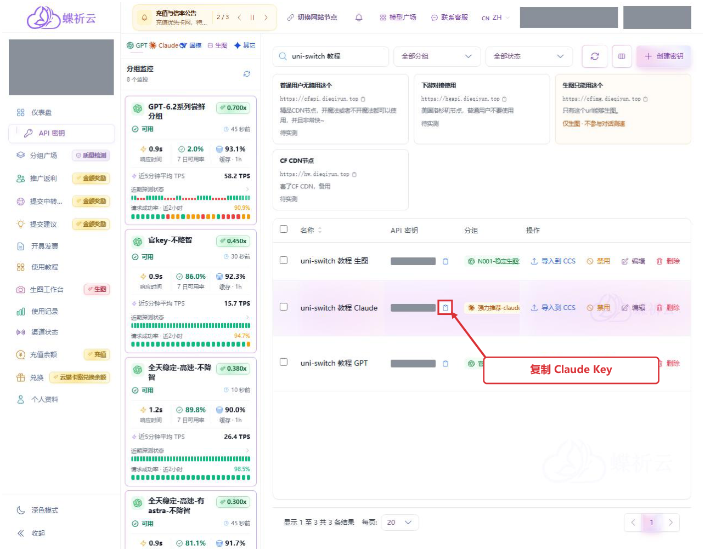

*图 22：完整密钥列表，灰块遮挡完整 Key，箭头指向 Claude 行的复制图标。*

### 已有供应商：点编辑

1. **回到 uni-switch**

   找到已经保存的「蝶祈云API」供应商卡片。

2. **点卡片上的「编辑」**

   进入同一个供应商的编辑窗口。

3. **下一步添加 Key 分组**

   把 Claude Key 加在这里即可。

> 已有 GPT 供应商的读者按本步操作。第一次只添加 Claude 的读者可直接按[在 uni-switch 添加蝶祈云供应商](#step-09)至[粘贴 Key，保留推荐项并添加](#step-10)。

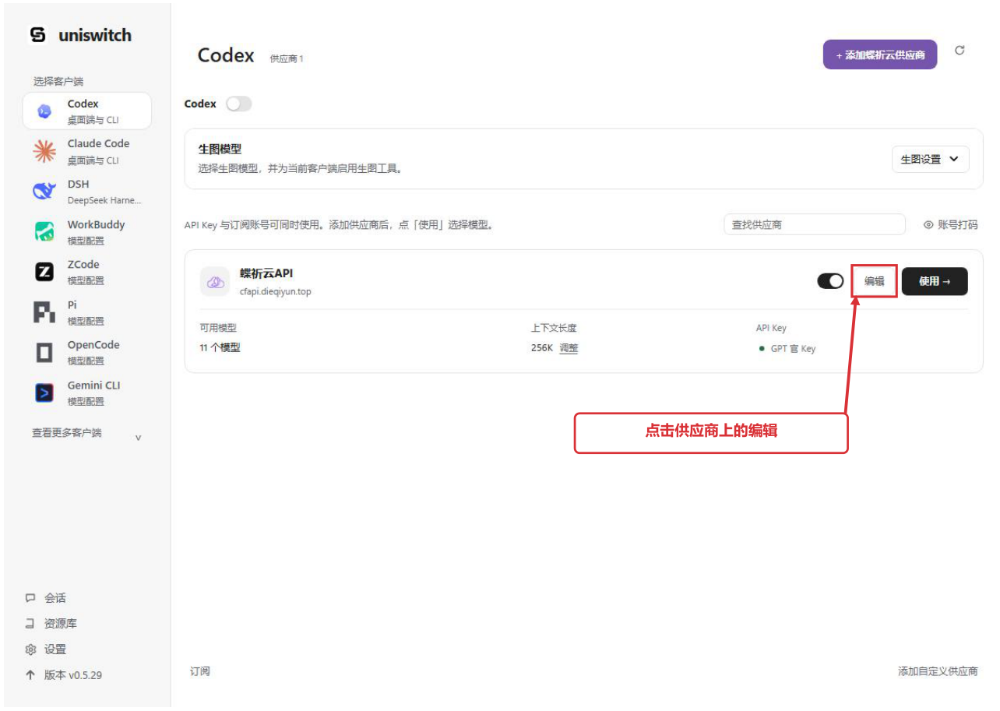

*图 23：完整主界面，箭头指向供应商卡片上的「编辑」。*

### 点添加 API Key 分组

1. **找到 API Key 分组区**

   编辑窗口上部显示已保存的 GPT 官 Key。

2. **点添加 API Key 分组**

   点击红框所在的整行按钮，展开新 Key 的填写区域。

> 同一供应商可以保存多组 Key，每组 Key 单独获取自己的模型。

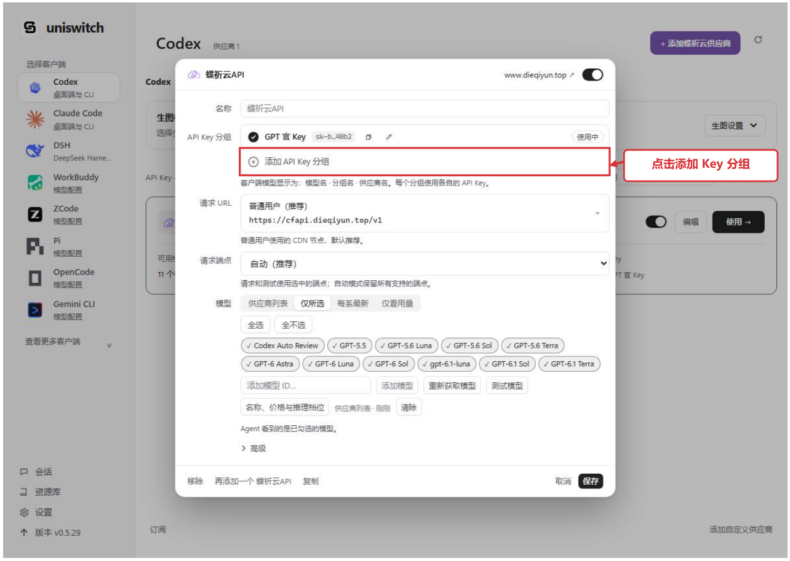

*图 24：完整供应商编辑窗口，保留已保存 Key、模型区和底部操作栏。*

### 填分组名，粘贴 Key，再点添加

1. **填本地分组名**

   例如「Claude 推荐」。

2. **粘贴 Claude Key**

   把网站复制的 Anthropic Key 粘贴到右侧输入框。

3. **点小表单里的添加**

   本次点的是输入框下面的「添加」。完成后还要执行下一步的「保存」。

> 不要用新 Key 覆盖原来的 GPT Key。把它作为另一组 Key 添加后，可分别选择两组模型。

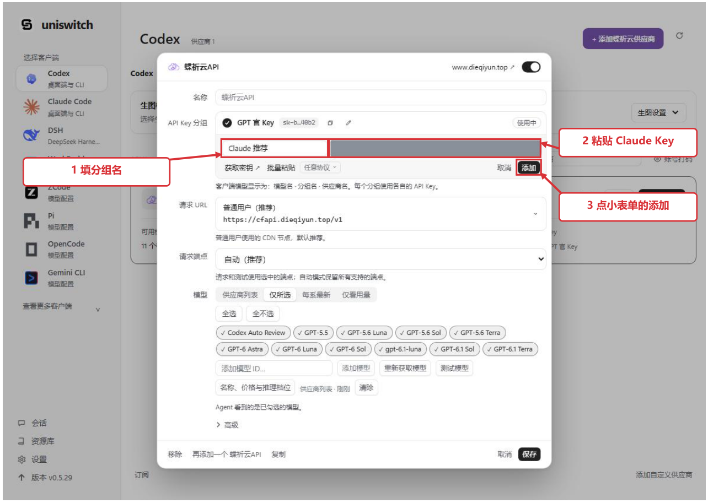

*图 25：完整编辑窗口与展开的小表单；完整 Claude Key 已遮挡。*

### 最后点右下角保存

1. **确认两组 Key 已存在**

   先在窗口上部的 API Key 分组区确认 GPT 官 Key 与 Claude 推荐均已添加。

2. **向下滚动，点保存**

   在编辑窗口内向下滚动，找到右下角「保存」，确认更改。

3. **去自己的客户端**

   Claude Code 接入见[Claude Code 接入](#claude-code)。

> 「添加」用于提交新 Key 分组；「保存」用于确认供应商窗口的全部更改。

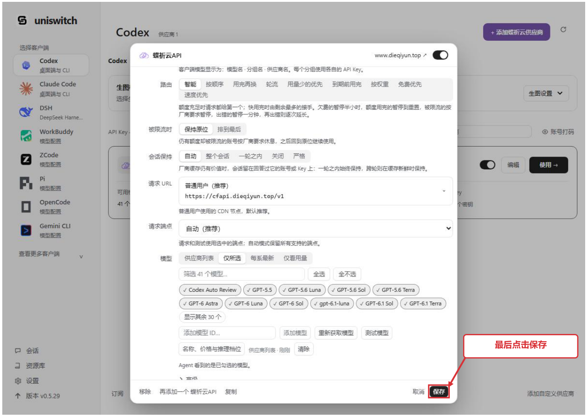

*图 26：完整软件界面；编辑窗口内部已向下滚动，箭头指向底部「保存」。*

## 四、接入 Codex

### 选客户端、打开开关、点使用

1. **左侧点「Codex」**

   先切换到你实际使用的客户端页面。

2. **打开上方接入开关**

   红框中的开关应处于开启状态。

3. **点卡片上的「使用 →」**

   下一步搜索并选择模型。

> 供应商只需添加一次。当前客户端的接入开关位于页面上方，按箭头位置操作。

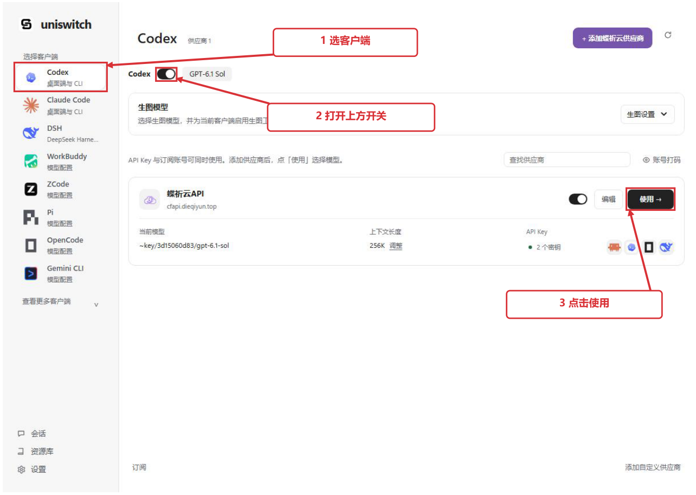

*图 27：完整 Codex 接入页，依次标出客户端入口、接入开关和「使用」。*

### 选择 GPT 模型并验证

1. **搜索模型**

   输入 gpt-6.1-sol，或自己 Key 有权限的模型名。

2. **点击搜索结果行**

   必须点模型这一行，才会完成选择并写入配置。

3. **重开 Codex 并测试**

   完全退出已有桌面端和 CLI 会话后再打开，新建会话。CLI 可用 /model 查看或切换模型。

> 测试消息：
> 请只回复四个字：接入成功。不要调用任何工具。
>
> 本教程已用真实 Key 验证 Codex CLI 返回「接入成功」。

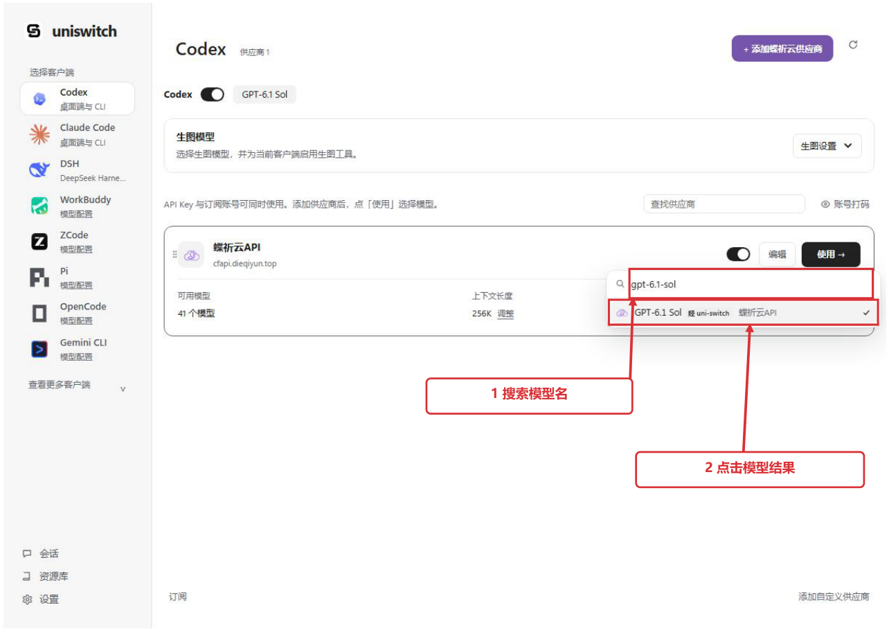

*图 28：完整模型选择页面。图中的模型为本次真实 Key 的操作示例，实际以自己的 Key 权限为准。*

## 五、接入 DSH（DeepSeek Harness）

### 选客户端、打开开关、点使用

1. **左侧点「DSH」**

   先切换到你实际使用的客户端页面。

2. **打开上方接入开关**

   红框中的开关应处于开启状态。

3. **点卡片上的「使用 →」**

   下一步搜索并选择模型。

> 供应商只需添加一次。当前客户端的接入开关位于页面上方，按箭头位置操作。

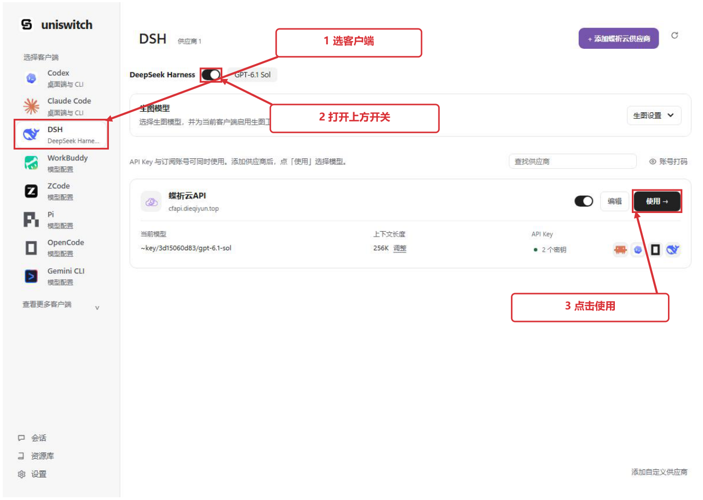

*图 29：完整 DSH 接入页，依次标出客户端入口、接入开关和「使用」。*

### 选择模型，再重开 DSH

1. **搜索模型**

   输入 gpt-6.1-sol，或自己 Key 有权限的模型名。

2. **点击搜索结果行**

   必须点模型这一行，才会完成选择并写入配置。

3. **重开 DSH 并测试**

   重新打开 DeepSeek Harness 并新建会话。下一步给出 DSH 内的新会话、模型和发送按钮位置。

> 测试消息：
> 请只回复四个字：接入成功。不要调用任何工具。
>
> 本教程已验证 DSH 桌面端收到真实模型回复。

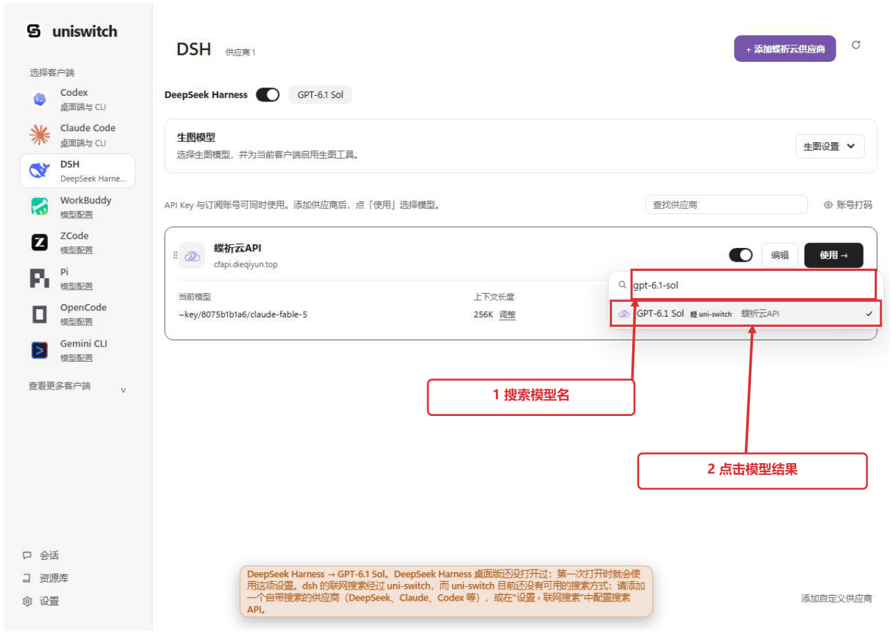

*图 30：完整模型选择页面。图中的模型为本次真实 Key 的操作示例，实际以自己的 Key 权限为准。*

### 新会话、确认模型、发送测试消息

1. **点左上角「新会话」**

   旧会话可能保留原来的模型。

2. **确认底部模型**

   教程显示 GPT-6.1 Sol、GPT 官 Key 和蝶祈云API。

3. **输入测试消息并发送**

   在底部输入框输入消息，点右侧发送箭头。正常收到回复即接入成功。

> 测试消息：
> 请只回复四个字：接入成功。不要调用任何工具。

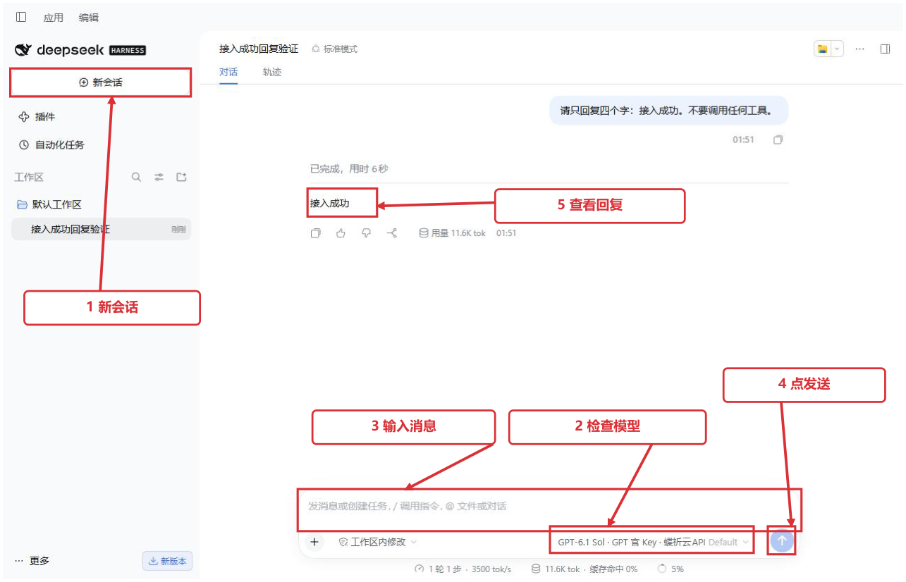

*图 31：真实 DSH 桌面端完整窗口，所选模型与「接入成功」回复均来自实际操作。*

## 六、接入 Claude Code

### 选客户端并开启接入

1. **左侧点「Claude Code」**

   先切换到你实际使用的客户端页面。

2. **打开上方接入开关**

   红框中的开关应处于开启状态。

3. **点卡片上的「使用 →」**

   下一步搜索并选择模型。

> 供应商只需添加一次。当前客户端的接入开关位于页面上方，按箭头位置操作。

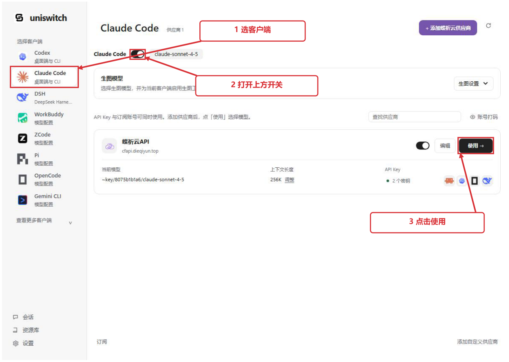

*图 32：完整 Claude Code 接入页，依次标出客户端入口、接入开关和「使用」。*

### 选择 Claude 模型并验证

1. **搜索模型**

   输入 claude-sonnet-4-5，或自己 Key 有权限的模型名。

2. **点击搜索结果行**

   必须点模型这一行，才会完成选择并写入配置。

3. **重开 Claude Code 并测试**

   重新打开 Claude Code，新建会话并发送测试消息。CLI 可用 /model 查看模型。

> 测试消息：
> 请只回复四个字：接入成功。不要调用任何工具。
>
> 已用真实 Anthropic 分组 Key 验证 Claude Code CLI 返回「接入成功」。需要 Claude Key 时先看[Claude Key 分组](#claude-keys)。

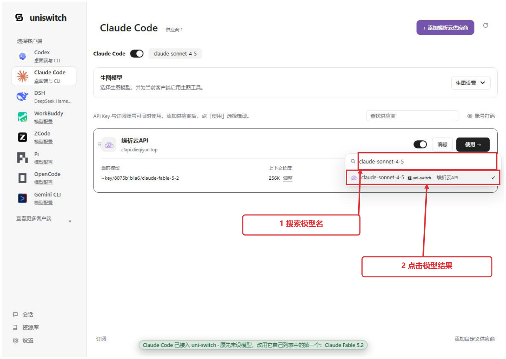

*图 33：完整模型选择页面。图中的模型为本次真实 Key 的操作示例，实际以自己的 Key 权限为准。*

## 七、接入 OpenCode

### 复用供应商并开启接入

1. **左侧点「OpenCode」**

   先切换到你实际使用的客户端页面。

2. **打开上方接入开关**

   红框中的开关应处于开启状态。

3. **点卡片上的「使用 →」**

   下一步搜索并选择模型。

> 供应商只需添加一次。当前客户端的接入开关位于页面上方，按箭头位置操作。

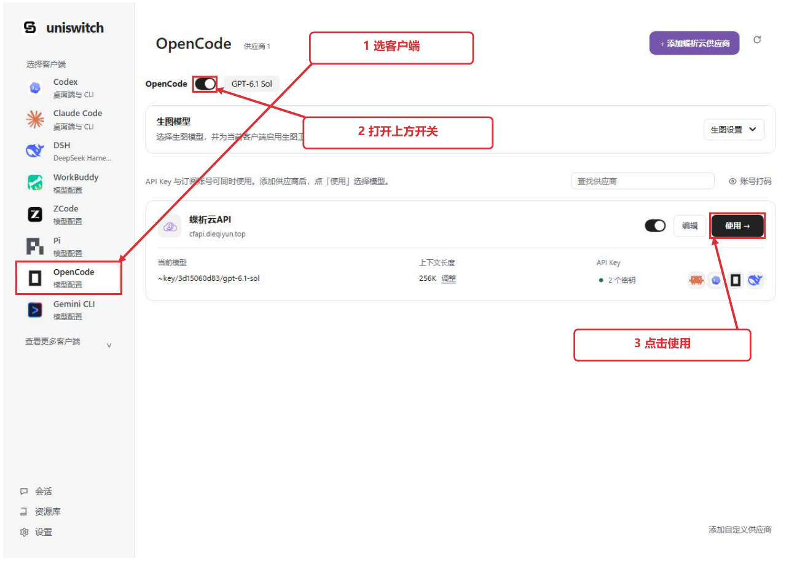

*图 34：完整 OpenCode 接入页，依次标出客户端入口、接入开关和「使用」。*

### 选择模型，在新会话中测试

1. **搜索模型**

   输入 gpt-6.1-sol，或自己 Key 有权限的模型名。

2. **点击搜索结果行**

   必须点模型这一行，才会完成选择并写入配置。

3. **重开 OpenCode 并测试**

   重新打开 OpenCode，新建会话。可用 /models 查看并选择对应模型，再发送测试消息。

> 测试消息：
> 请只回复四个字：接入成功。不要调用任何工具。
>
> 本教程已核实 OpenCode 的配置写入和模型选择；真实对话实测覆盖 Codex CLI、Claude Code CLI 与 DSH 桌面端。

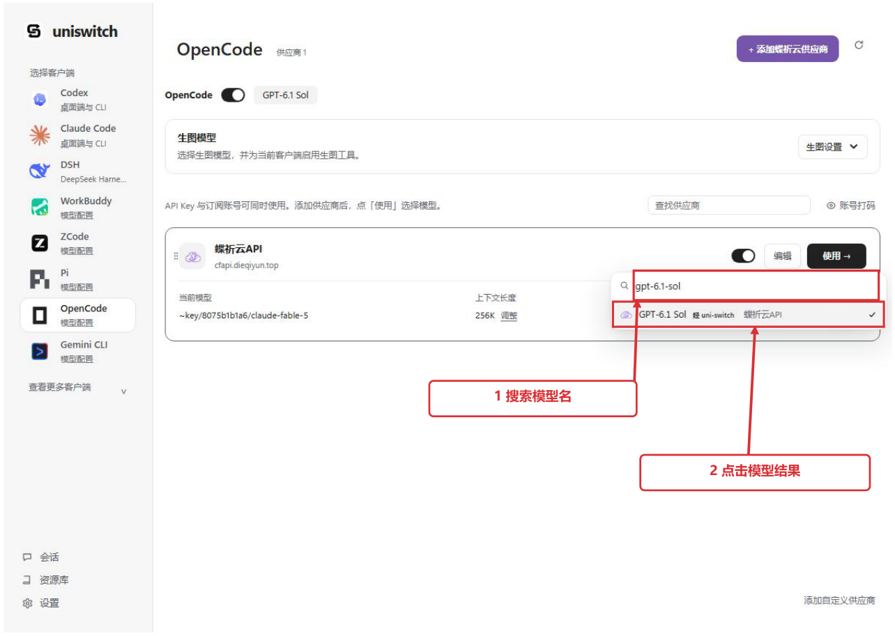

*图 35：完整模型选择页面。图中的模型为本次真实 Key 的操作示例，实际以自己的 Key 权限为准。*

## 遇到问题：按现象核对

| 遇到的现象 | 先检查什么 |
| --- | --- |
| 点使用后提示先接入 | 打开当前客户端页面上方的接入开关，再点「使用」。参考对应客户端页的第 2 个箭头。 |
| 没有模型或提示无权限 | 核对网站创建 Key 时的厂商与分组；GPT 与 Claude 权限可能不同。回到供应商编辑页获取模型。 |
| 密钥无效 / 401 | 重新复制完整 API Key，检查首尾空格、网站上是否启用、是否过期。不要照抄截图里被遮挡的 Key。 |
| 余额不足 | 登录蝶祈云，检查账户余额或套餐是否可用。 |
| 没有生图模型 | 使用网站「生图」厂商下的 Key，并检查所选生图分组的权限；GPT 文字 Key 可能没有生图权限。 |
| 文字正常但无法生图 | 展开当前客户端的「生图设置」，确认生图模型已选、该客户端生图工具已开启，再重开客户端或新建会话。 |
| 客户端没出现新模型 | 完全退出后重新打开，建立新会话；必要时在客户端自己的模型菜单中选择。 |
| 无法连接或请求超时 | 确认 uni-switch 正在后台运行，请求 URL 保持「普通用户（推荐）」，再检查网络与服务状态。 |
| DSH 保留旧模型 | 点左上角「新会话」，检查输入框下方的模型选择器，参考[新会话、确认模型、发送测试消息](#step-31)。 |

### 常用地址

蝶祈云官网与控制台入口：[https://www.dieqiyun.top/](https://www.dieqiyun.top/)

[uni-switch 下载与版本列表](https://github.com/dieqiyun/uni-switch/releases)

文字 API：https://cfapi.dieqiyun.top/v1　｜　生图 API：https://cfimg.dieqiyun.top/v1。使用内置入口时保留默认地址即可。

完成路径：创建并复制 Key → 添加蝶祈云供应商 → 选客户端 → 开启上方接入开关 → 使用 → 点击模型 → 重开客户端并新建会话 → 收到回复。

### 截图与验证说明

采集日期：2026 年 11 月 16 日。软件界面为 uni-switch 0.5.29。全部操作截图保留完整可见网页或软件窗口，未裁成局部按钮或独立表单；网站弹窗保留其所在页面。本页图片保留了原 PDF 中的编号、红框和箭头。账号摘要、余额与完整 API Key 已遮挡。

网站、软件、模型目录和 DSH 对话均来自真实操作。生图已核实真实 Key 获取模型、选择模型与客户端工具开关，未在本文展示实际出图结果。模型列表为本次真实 Key 下的操作示例；实际模型、权限、分组价格、排名和页面布局，以读者自己的 Key 权限与当时页面为准。使用 API 可能消耗额度。
